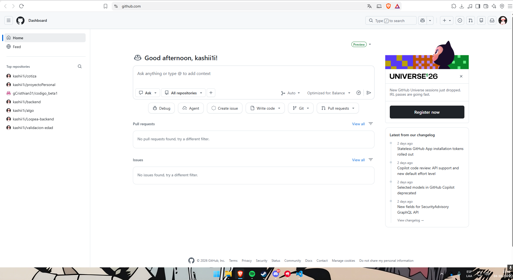
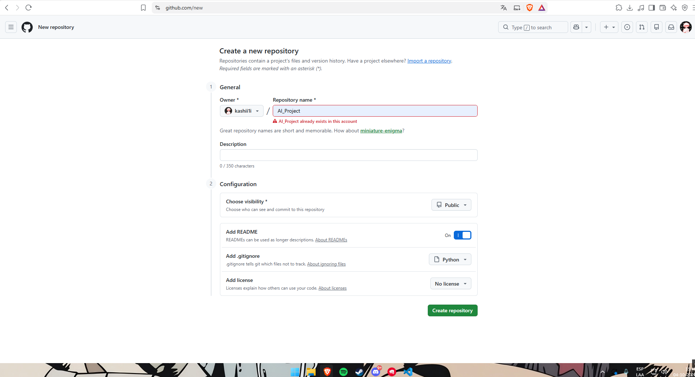
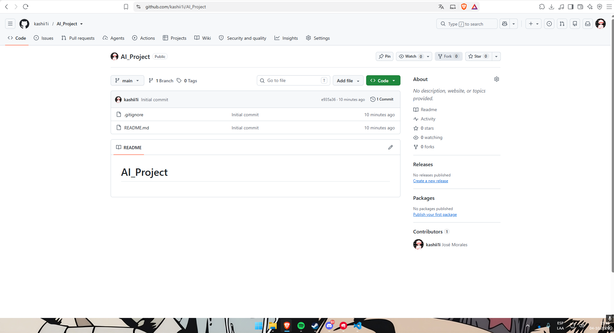
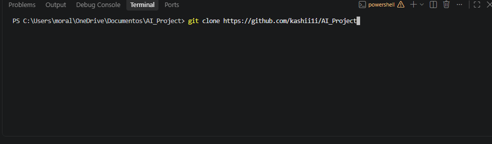
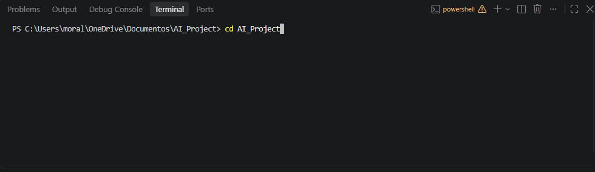
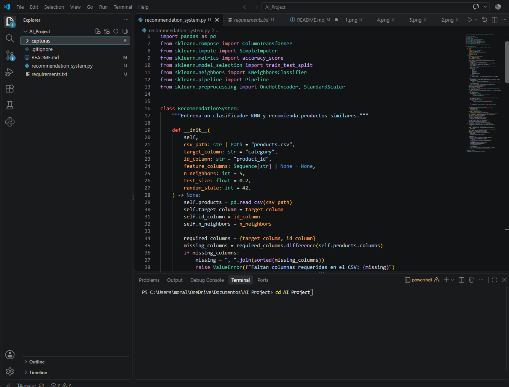

# AI_Project

Proyecto de recomendación de productos en Python. Este README documenta la
configuración de GitHub y Visual Studio Code, y cómo ejecutar el programa.

## Proceso de configuración

### 1. Abrir GitHub

Desde un navegador, visita [github.com](https://github.com/). Crea una cuenta si
aún no tienes una; si ya tienes cuenta, inicia sesión. La primera captura muestra
el panel de GitHub con la sesión iniciada.



### 2. Solicitar acceso de estudiante a GitHub Copilot

Entra en GitHub Education con tu cuenta y sigue el proceso para solicitar la
verificación de estudiante. Completa los datos que solicite GitHub y aporta la
información necesaria para acreditar tu condición de estudiante. Cuando la
verificación esté aprobada, revisa las opciones de Copilot disponibles para tu
cuenta y activa el acceso que corresponda.

### 3. Elegir la alternativa gratuita

En la página de planes o precios de Copilot, revisa las alternativas que aparezcan
para tu cuenta y selecciona la opción gratuita, si es la que deseas usar. Las
condiciones y los nombres de los planes pueden cambiar; confirma el plan activo
en la página antes de continuar.

### 4. Verificar el correo electrónico

Introduce el correo asociado a tu cuenta cuando GitHub lo solicite. Abre el
mensaje de verificación enviado por GitHub y sigue el enlace o introduce el código
indicado. Después vuelve a GitHub y confirma que el correo aparezca como
verificado en la configuración de la cuenta. Las capturas disponibles no incluyen
la pantalla de solicitud estudiantil ni la de verificación del correo.

### 5. Iniciar sesión y comprobar el acceso

Inicia sesión con la cuenta verificada. El panel de la captura muestra la sesión
de GitHub abierta y el espacio para interactuar con Copilot. La disponibilidad de
las funciones de Copilot dependerá del plan que se haya activado.


### 6. Crear el repositorio

En GitHub, usa **New** o el botón **+** para abrir el formulario de creación de
repositorios. Escribe un nombre, por ejemplo `AI_Project`, y selecciona la
visibilidad **Public** o **Private** según el uso previsto. Puedes activar la
creación de un README, elegir una plantilla de `.gitignore` para Python y añadir
una licencia si el proyecto la necesita. Finalmente, pulsa **Create repository**.

La captura del formulario muestra `AI_Project`, visibilidad pública, README
activado, plantilla Python para `.gitignore` y la opción **No license**. También
muestra un aviso de que ese nombre ya existe en la cuenta; en ese caso no crees un
duplicado: abre y utiliza el repositorio existente.



La siguiente imagen muestra el repositorio `AI_Project` existente, su visibilidad
pública, la rama `main` y los archivos iniciales `.gitignore` y `README.md`.



### 7. Clonar el repositorio

En la página del repositorio, abre **Code**, copia la URL HTTPS y, en Visual Studio
Code, abre una terminal integrada. Desde la carpeta que contendrá el proyecto,
ejecuta `git clone` con la URL copiada y pulsa Enter. Por ejemplo:

```powershell
git clone https://github.com/kashii1i/AI_Project.git
```

La captura muestra el comando preparado en la terminal. Si ya estás dentro de la
carpeta local `AI_Project`, no vuelvas a clonarlo allí; abre una terminal en la
carpeta padre o continúa usando la copia local existente.



### 8. Entrar en la carpeta del proyecto

Después de clonar, cambia al directorio creado con `cd AI_Project`. Este comando
se ejecuta desde la carpeta padre del repositorio. La captura muestra el comando
en la terminal; si el prompt ya termina en `AI_Project`, ya estás dentro y no
necesitas volver a ejecutar `cd AI_Project`.



### 9. Crear el archivo Python con Copilot

Abre la carpeta del repositorio en VS Code. En el explorador, crea
`recommendation_system.py`. Abre el chat de GitHub Copilot o usa Copilot en el
editor para pedir un sistema de recomendación en Python con pandas y
scikit-learn. Revisa el código generado, comprueba los nombres de las columnas
que espera el programa y guarda los cambios.

La captura muestra `recommendation_system.py` abierto en VS Code y el proyecto en
el explorador. El código implementa una clase `RecommendationSystem` con
`KNeighborsClassifier`, preprocesamiento de variables y una función
`recommend`.



### 10. Documentar el proyecto

Actualiza este `README.md` con el proceso realizado, los comandos utilizados y
las capturas guardadas en `capturas/`. Las rutas de las imágenes se escriben de
forma relativa al README, por ejemplo `capturas/1.png`, para que GitHub también
las muestre al visitar el repositorio.

## Ejecutar el recomendador

Instala las dependencias desde la carpeta del proyecto:

```bash
pip install -r requirements.txt
```

Coloca `products.csv` en la carpeta desde la que ejecutarás el programa. El CSV
debe incluir `product_id` para identificar los productos y `category` como
etiqueta que aprenderá el clasificador. De forma predeterminada, las demás
columnas se usan como características, excepto campos identificadores o
descriptivos comunes (`name`, `product_name`, `title`, `description`,
`product_description` y `sku`). Se admiten características numéricas y
categóricas.

Ejecuta el sistema con:

```bash
python recommendation_system.py
```

El programa divide los datos en conjuntos de entrenamiento y prueba, entrena el
clasificador y muestra la exactitud (*accuracy*) obtenida en el conjunto de
prueba. También se puede usar desde otro archivo Python:

```python
from recommendation_system import RecommendationSystem

system = RecommendationSystem("products.csv")
print(f"Accuracy: {system.accuracy:.2%}")
print(system.recommend(product_id=123, n=5))
```

El método `recommend` devuelve hasta cinco productos similares por defecto,
excluye el producto consultado y añade la distancia calculada por KNN. Puedes
cambiar el número con `n`, especificar características con `feature_columns` o
cambiar la etiqueta con `target_column`.